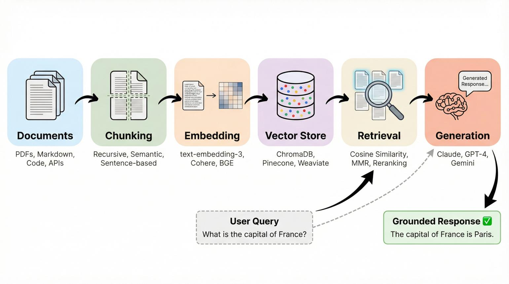
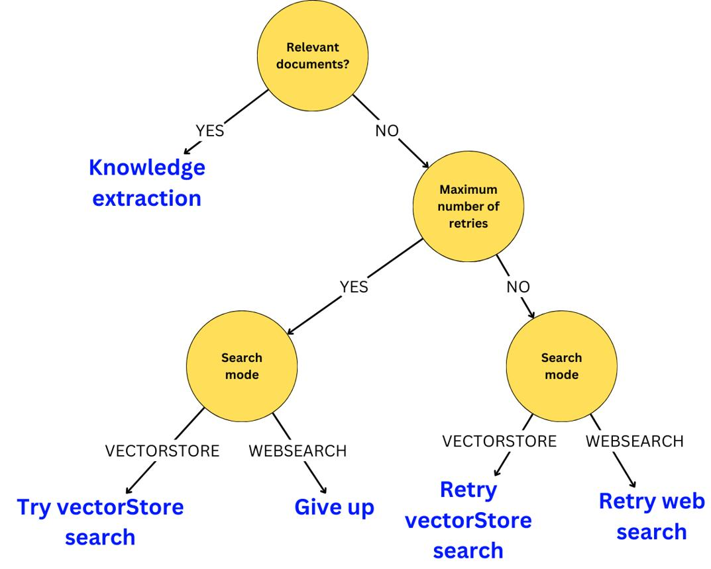
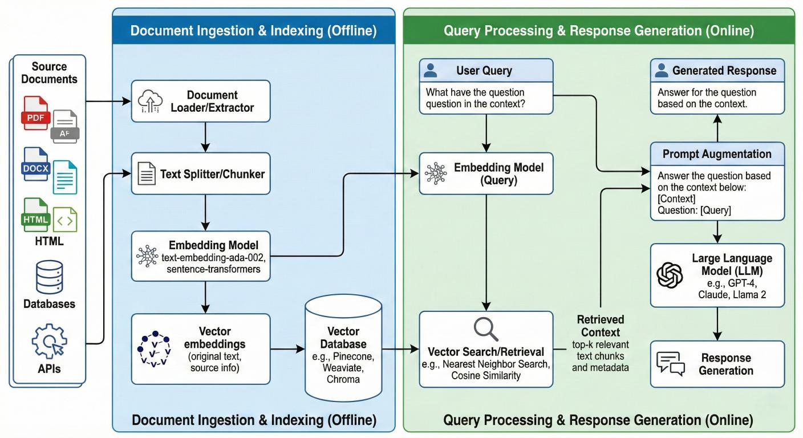

# Recall — System Architecture

## 1. Overview

Recall is a local AI-powered knowledge assistant designed to help users retrieve, understand, and use information from their own documentation.

The current implementation provides a single-domain RAG pipeline and a multi-domain entry point that coordinates retrieval across configured knowledge domains. Both supply retrieved passages to a language model running through LM Studio.

The long-term goal is to evolve Recall into a modular assistant that can manage multiple specialized knowledge domains, perform global searches across the available documentation, and coordinate retrieval through a central orchestrator.

The architecture distinguishes three categories:

* **Implemented:** functionality present in the current codebase.
* **Planned:** functionality intended for future development.
* **Long-term vision:** capabilities that depend on earlier architectural milestones.

The immediate use case is to support technical learning and professional development. Generalizing Recall into a learning assistant for other users remains a possible future product direction, not a current implementation requirement.

## 2. Current RAG Pipeline



The current RAG pipeline follows these steps:

1. **Document loading:** loads documents from the specified directory.
2. **Chunking:** splits document content into smaller segments with configurable chunk size and overlap.
3. **Embedding generation:** converts document chunks and the user's question into vectors.
4. **Similarity search:** computes cosine similarity between the question embedding and document chunk embeddings.
5. **Source ranking:** filters chunks using the configured score threshold and ranks sources using the maximum score among their retained chunks.
6. **Context construction:** assembles the selected chunks into a textual context.
7. **Prompt construction:** combines the context, question, and answer-mode instructions.
8. **Answer generation:** sends the prompt to the generation model through LM Studio.
9. **Response:** returns the generated answer, the unique source names, and the answer mode.

The current embedding implementation uses an in-memory LRU cache to avoid redundant embedding requests for repeated inputs.

## 3. Adaptive Retrieval Fallback



### Current implementation

The current implementation distinguishes between two answer modes:

* `local`: at least one search result was retained.
* `model`: no search results were retained.

The mode is selected according to whether retrieval returns any results. `get_answer()` handles one document directory; `get_answer_for_domains()` handles an explicit collection of `KnowledgeDomain` instances.

The selected mode is passed to `build_prompt()`, which constructs the prompt used for generation.

The RAG response contains:

```python
{
    "answer": response,
    "sources": sources,
    "answer_mode": answer_mode,
}
```

The `sources` field contains unique source names associated with the retrieved chunks.

### Current limitation

The presence of search results does not guarantee that the retrieved context contains enough information to answer the question.

The current fallback distinguishes an empty result set from a non-empty result set. It does not independently evaluate whether the retrieved context is sufficient to answer the question.

Cosine similarity scores are measures of embedding similarity, not calibrated probabilities of relevance or factual correctness.

For non-empty retrieval results, `build_prompt()` instructs the model to support factual claims with retrieved context, avoid filling gaps with general knowledge, treat retrieved text as reference material, and report when the context lacks the answer. These instructions do not guarantee that the generated answer is grounded.

### Planned improvements

Future improvements may include:

* Evaluating retrieval quality using representative questions.
* Detecting insufficient or weakly relevant context.
* Expanding retrieval when the initial results are insufficient.
* Making answer provenance explicit.
* Evaluating whether generated answers are supported by retrieved passages.

These improvements must be evaluated before being considered implemented.

## 4. Current RAG Data Flow



### Inputs

* **Document directory:** location of the documents to search.
* **Question:** the user's query.
* **Retrieval parameters:** chunk size, overlap, number of sources to select, and similarity score threshold.

### Processing

The document loader reads the available documents and produces chunks.

Recall generates embeddings, computes cosine similarity scores, filters the results, and selects the highest-ranked sources.

The selected chunks are assembled into a textual context. The prompt builder combines the context with the question and answer-mode instructions. The generation client sends the resulting prompt to LM Studio.

### Output

The existing `get_answer()` function keeps this response contract:

```python
{
    "answer": response,
    "sources": sources,
    "answer_mode": answer_mode,
}
```

The `sources` field contains unique source names associated with the retrieved chunks.

Although the search layer exposes `chunk_score` and `source_score`, these scores are not currently included in the final RAG response.

`get_answer_for_domains()` returns the same top-level keys. Its `sources` value contains records with `domain` and `source` fields, so equal filenames from different domains remain distinguishable.

## 5. Main Components

| Component            | Responsibility                                                                                           |
| -------------------- | -------------------------------------------------------------------------------------------------------- |
| `document_loader.py` | Loads documents from the specified directory.                                                            |
| `chunking.py`        | Splits document content into chunks.                                                                     |
| `embeddings.py`      | Generates embeddings and maintains an in-memory LRU cache.                                               |
| `similarity.py`      | Computes cosine similarity.                                                                              |
| `search.py`          | Scores chunks, filters by threshold, aggregates source scores, and selects sources.                      |
| `prompt.py`          | Builds the prompt from the context, question, and answer mode.                                           |
| `lmstudio_client.py` | Communicates with LM Studio for answer generation.                                                       |
| `models.py`          | Defines knowledge domains with a name, document directory, description, and UUID.                            |
| `rag.py`             | Provides reusable retrieval and coordinates single-domain or multi-domain answer generation.                 |
| `config.py`          | Provides application configuration.                                                                      |

The multi-domain orchestrator receives domains explicitly from its caller. Persistent domain registration and automatic query-based domain selection are not implemented.

## 6. Search Scoring

Recall uses cosine similarity to compare the question embedding with each document chunk embedding.

The `score_threshold` parameter filters chunks before source ranking. Its default value is `0.0`.

For each source, Recall uses the maximum score among its retained chunks as the source score.

The `top_k` parameter determines the number of sources selected, not the total number of chunks returned. Multiple chunks from a selected source may be included in the final context.

These scores measure embedding similarity. They should not be interpreted as calibrated confidence values or proof that a chunk contains a complete and correct answer.

## 7. Embedding Cache

Recall maintains an in-memory Least Recently Used (LRU) cache for embeddings.

The cache has a maximum capacity of 1,024 entries. Cache keys include the embedding model and input text.

Repeated texts can reuse cached embeddings, and missing unique texts are sent to the embedding endpoint in batches.

The cache is not persistent and is cleared when the process terminates. It reduces redundant embedding API calls but does not replace a persistent document index.

## 8. Design Principles

The architecture follows these principles:

* **Local-first processing:** document retrieval and model inference are designed to use local resources.
* **Separation of concerns:** loading, chunking, embedding, search, prompting, and generation are handled by separate modules.
* **Configurable retrieval:** chunking and search behavior can be adjusted through parameters.
* **Transparent sourcing:** the current response includes the names of documents used to build the context.
* **Testability:** individual components can be tested independently, including with mocked model interactions.
* **Explicit limitations:** retrieval scores are treated as similarity measures, not guarantees of factual correctness.
* **Modularity:** future knowledge domains should be configurable rather than implemented as separate copies of the RAG engine.
* **Incremental evolution:** new capabilities should preserve the existing pipeline unless a measured limitation justifies a change.

## 9. Current Limitations and Planned Improvements

The current implementation has the following limitations:

* No persistent embedding index.
* Basic word-count-based chunking.
* No comprehensive retrieval evaluation dataset.
* No calibrated relevance threshold.
* No source or chunk scores in the final RAG response.
* No independent assessment of whether the retrieved context sufficiently answers the question.
* Cross-domain ranking assumes that all domains use the same embedding model and retrieval settings.
* No evaluation of cross-domain retrieval quality or latency.
* No persistent domain registry or automatic domain selection.

Potential improvements to the current engine include:

1. Evaluating retrieval quality with a representative question dataset.
2. Improving chunking and context selection.
3. Exposing source metadata and scores through the RAG response.
4. Adding persistent indexing if performance measurements justify it.
5. Evaluating answer grounding and behavior when context is insufficient.

The current multi-domain implementation and remaining limitations are described below.

## 10. Target Architecture: Multiple Knowledge Domains

The current `KnowledgeDomain`, `retrieve_documents()`, and `get_answer_for_domains()` provide an initial multi-domain implementation. Callers pass domains explicitly. Persistent registration, automatic domain selection, and empirical evaluation remain planned.

### Knowledge domains

A knowledge domain represents a specialized collection of documents, such as Python or Docker documentation. The current model stores its name, document directory, optional description, and UUID. Retrieval behavior is shared; domain-specific copies of the RAG pipeline are not needed.

The initial domain model should remain small. Per-domain model selection, custom prompt policies, and other overrides should be introduced only when concrete use cases require them.

### Shared retrieval and orchestration

The current multi-domain flow is:

```text
Question
   |
   v
Caller supplies domains explicitly
   |
   v
Shared retrieval engine for each selected domain
   |
   v
Combine and rank retrieved passages
   |
   v
Build context and prompt
   |
   v
Local language model
   |
   v
Answer with source and domain provenance
```

The orchestrator coordinates retrieval calls and result aggregation. It does not duplicate document loading, embedding, similarity scoring, prompt construction, or model communication. The current ranking compares scores across domains, so all domains must use the same embedding model and retrieval settings. Orchestration is deterministic; an autonomous agent is unnecessary unless requirements later call for iterative tool selection or planning.

### Retrieval result contract

Global retrieval preserves the domain, source, chunk content, and retrieval scores internally. Context labels both domain and source. Results are ranked by each domain/source pair's maximum chunk score, then domain name, source name, and caller-supplied domain order for deterministic tie breaking. Scores from different embedding models or domain-specific configurations must not be treated as directly comparable.

The final answer should retain source and domain provenance so users can see which collections contributed evidence. Handling duplicate passages, empty domains, and domains that fail to retrieve should be defined as part of the implementation contract.

### Incremental implementation milestones

1. ~~Define a minimal knowledge-domain model.~~
2. ~~Extract a reusable retrieval operation while preserving the `get_answer()` contract.~~
3. ~~Accept an explicit collection of domains for retrieval.~~
4. ~~Aggregate results with deterministic ranking and domain/source provenance.~~
5. ~~Provide a multi-domain answer entry point while preserving single-domain behavior.~~
6. Evaluate retrieval quality and latency against representative single-domain and multi-domain queries before tuning selection or ranking.

Each milestone should be independently testable. The current pipeline remains the reference implementation until these steps are implemented and validated.
